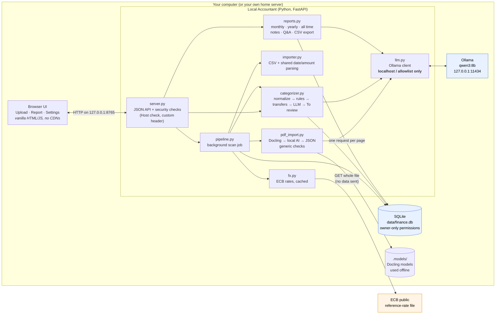
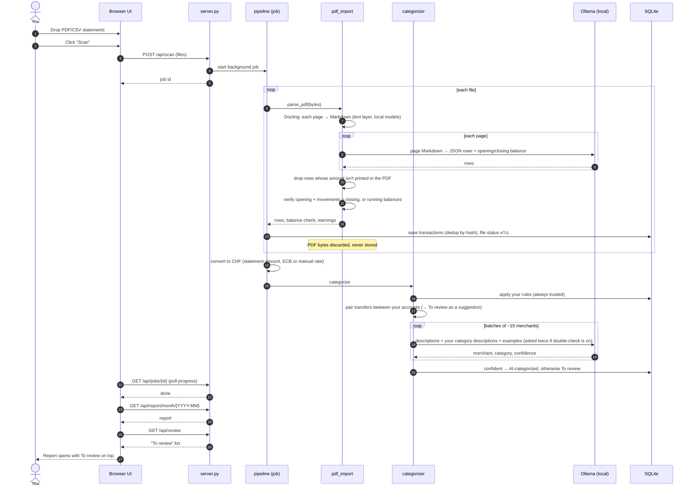
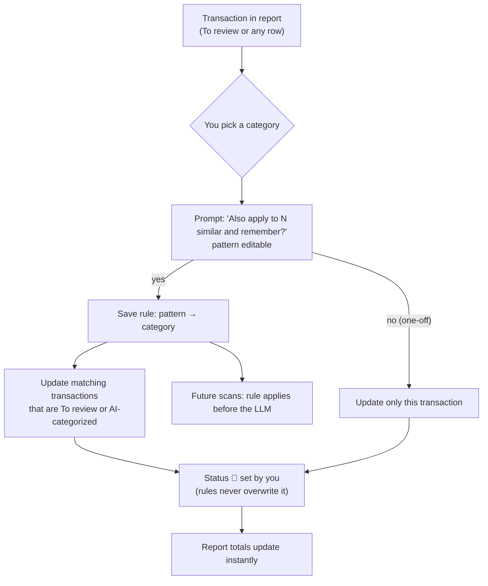
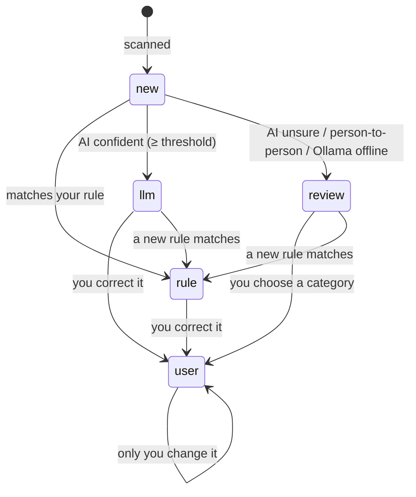
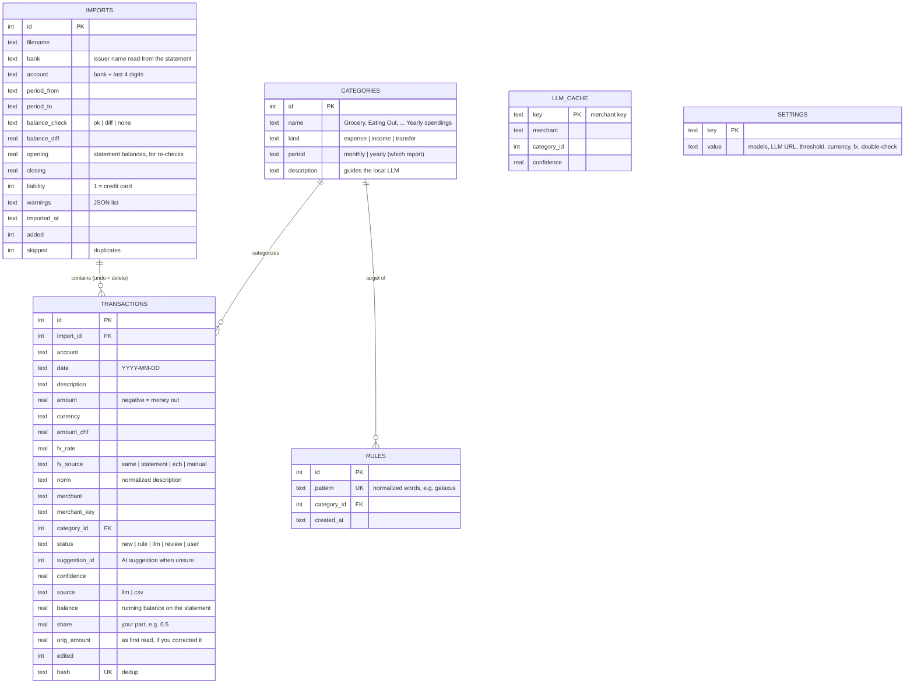
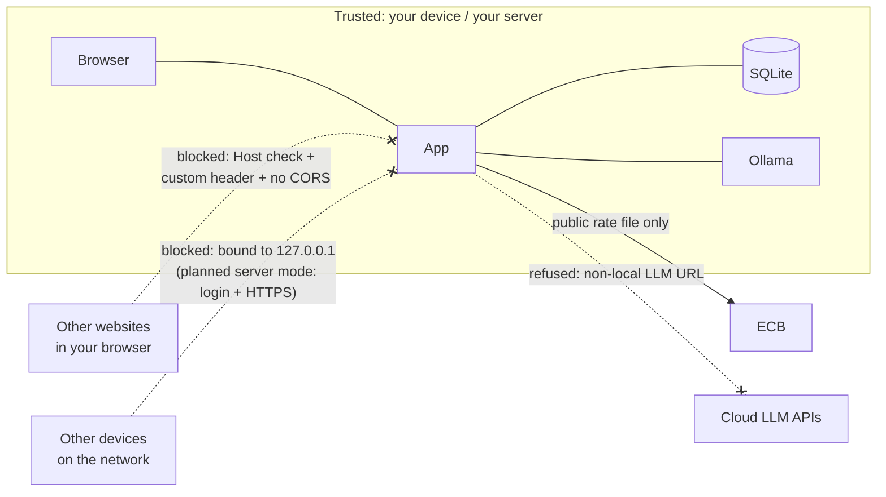

# Architecture

This document shows how Local Accountant is put together.

**Guiding rule:** your statements and transactions never leave the machine (or your own
server). While the app runs, the only outgoing internet request is a download of the public
ECB exchange-rate file, which contains no personal data. (On first run, setup also downloads
the dependencies and Docling's models once.)

## 1. Components

| Module | Responsibility |
|---|---|
| `server.py` | Serves the UI and the JSON API. Security checks: validates the `Host` header (blocks DNS rebinding), requires a custom header on writes (blocks cross-site requests), and sets a strict Content-Security-Policy. `start.py` binds it to 127.0.0.1. Login for server mode is planned, not built. |
| `pdf_import.py` | Any bank, no per-bank rules. **Docling** turns each page into Markdown (layout and tables, from the PDF's own text layer, with models stored locally in `.models/`). The **local AI** turns each page into JSON transactions. **Generic checks** follow: every amount must be printed in the PDF (otherwise the row is dropped), made-up balances are removed, and opening + movements = closing or the running balances must follow row by row. Scanned PDFs without a text layer are rejected (no OCR yet). |
| `importer.py` | Imports CSV files (auto-detects encoding, delimiter, header and columns). Also holds the date and amount parsing shared with the PDF importer, e.g. `1'234.50` and `1 234,56`. |
| `pipeline.py` | The background scan job. Each file goes through: parse → save (deduplicated) → convert to CHF → categorize. The UI polls it for per-file progress. Also re-runs a file's balance check after you correct a row. |
| `categorizer.py` | Categorizes transactions: your rules (including ~40 starter Swiss merchants) first, then transfer pairing, then the local LLM. The LLM is asked twice ("double-check"); if its answers disagree, or confidence is below the threshold, the item goes To review. Remembering a rule never overwrites your manual choices. |
| `textutil.py` | Normalizes descriptions (removes card numbers, dates, boilerplate), does whole-word rule matching, and masks account numbers to their last 4 digits. |
| `reports.py` | Builds the monthly report (monthly costs, plus yearly costs listed separately), the yearly report (yearly costs, 12-month table, set-aside), the all-time view, LLM notes, Q&A and CSV export. |
| `fx.py` | Converts non-CHF amounts with ECB daily reference rates, using cached cross rates. |
| `llm.py` | Ollama client. It refuses any non-loopback or non-allowlisted host and ignores system proxies. |
| `db.py` | SQLite schema and migrations, default categories, default and starter rules, settings. |
| `domain.py` | Shared types (TypedDicts) used across the app. |
| `static/` | Web UI: plain HTML/CSS/JS, no external assets. |

Folders in the project:

| Folder | Contents |
|---|---|
| `app/` | The modules above. `start.py` (the launcher) sits next to it. |
| `tests/` | pytest suite, synthetic statement generators, simulated AI, live tests and the AI accuracy eval (see [EVAL.md](EVAL.md)) |
| `sample/` | Synthetic statement PDFs (made-up data): PostFinance-, Swisscard- and Wise-style, plus three "unseen" layouts |
| `docs/` | This file, [EVAL.md](EVAL.md), [pdf-extraction-options.md](pdf-extraction-options.md) |
| `data/` | Your database and the cached ECB file. Created on first run; never commit it. |
| `.models/` | Docling's models, downloaded once |

## 2. Scan flow (Upload → Scan → Report)

## 3. Review and correction loop

Each transaction moves through these statuses:

## 4. Data model

## 5. Trust boundaries

